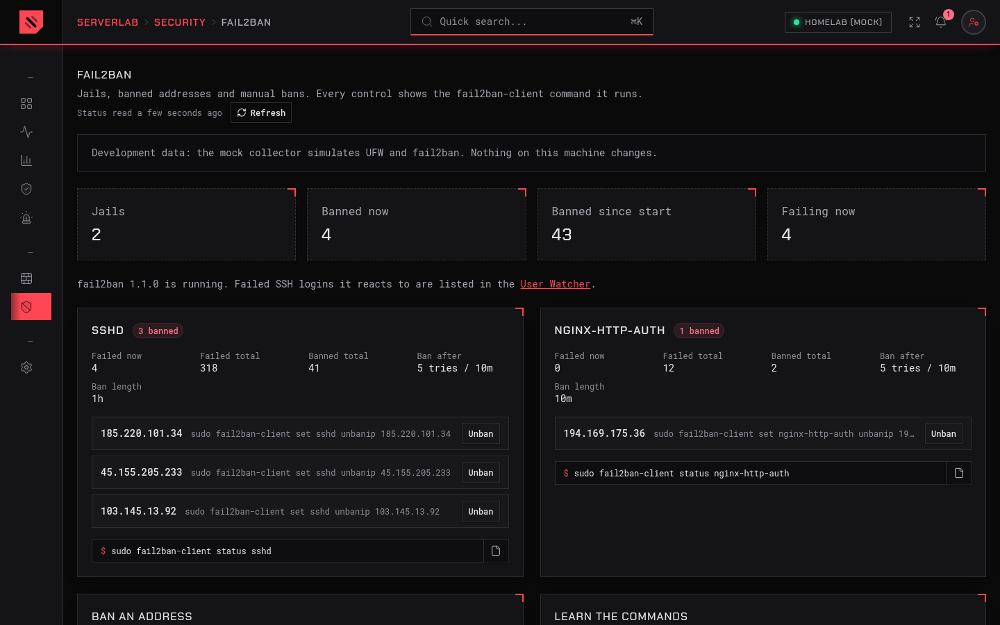

<p align="center">
  <picture>
    <source media="(prefers-color-scheme: dark)" srcset="branding/logo-dark.svg">
    
  </picture>
</p>

<p align="center">
  A small, Grafana-like dashboard for <strong>one homelab server</strong>.<br>
  It runs on the server it watches, keeps everything in SQLite, and is reachable only over your Tailscale tailnet.
</p>

<p align="center">
  <a href="LICENSE"></a>
  
  
</p>


## What it shows

ServerLab answers a handful of questions about your box, quickly:

| Page | What you get |
|---|---|
| **Lobby** | Everything hosted on the server: Docker containers, systemd services, nginx sites and databases, with icons, health, uptime and "Open" links. Flags anything exposed to your LAN instead of only the tailnet. Add what it misses by hand. |
| **Resources** | Live CPU, GPU (NVIDIA, AMD, Intel, several at once), memory, temperatures, network and disk, plus 24 h / 7 d / 30 d history. |
| **Applications** | CPU and memory per app, ranked, as a share of the host and in real units. |
| **User Watcher** | SSH and web logins with user, time, result and offline geolocation. Imports the history already on the server. |
| **Alerts** | High CPU, disk almost full, SSH brute force, login from a new country, service down, certificate expiring. Sent to ntfy, Discord, Telegram or in-app. |
| **Firewall** | UFW on/off, default policies, numbered rules, add and delete rules. **Every control shows the `ufw` command it runs.** |
| **fail2ban** | Jails, banned addresses, unban and manual ban, or the setup steps when fail2ban isn't installed. **Every control shows the `fail2ban-client` command it runs.** |

### Learn the command line while you click

The Firewall and fail2ban pages are built to teach. Fill in the add-rule form and the exact command updates as you type. Every change shows the command that ran, with its output, in an activity log, and each page ends with a short reference of related commands. Anything you do in the UI, you can copy and do yourself over SSH.

| Firewall | fail2ban |
|---|---|
|  |  |

The Firewall page refuses to turn UFW on, or to remove the last rule that lets you in over SSH or Tailscale, unless you confirm you have another way into the machine.

### On your phone

The menu becomes a drawer on small screens: tap outside it, tap a link, or press Escape to close it.

<p>
  
  &nbsp;
  
</p>

## How it works

```
 browser ──tailnet──▶ nginx (Tailscale IP, TLS) ──▶ serverlab-web  (Next.js, 127.0.0.1:3000)
                                                         │ reads / writes requests
                                                         ▼
                                                   SQLite (/var/lib/serverlab)
                                                         ▲ writes samples, runs requests
                                                         │
                                                  serverlab-collector ──▶ /proc, /sys, Docker (GET only),
                                                         │                 journal, nginx configs, GPU tools
                                                         ▼ only for firewall / fail2ban changes
                                       serverlab-host-action.service (root, one-shot, ufw + fail2ban-client only)
```

- **Two unprivileged services.** `serverlab-web` and `serverlab-collector` run as the `serverlab` user with a strict systemd sandbox. The web process never touches the host.
- **Read-only monitoring.** ServerLab never starts, stops or changes containers and services.
- **Two narrow ways to change the host**, both through polkit rules that allow starting exactly one kind of root unit:
  - the Firewall and fail2ban pages, through a small root helper that re-checks every request and runs only `ufw` and `fail2ban-client`, without a shell;
  - an opt-in NVIDIA GPU power switch on hybrid-graphics laptops.

  Details and how to remove them: [HARDENING §6](docs/HARDENING.md#6-serverlab-process-privileges).

Built with Next.js 16, React 19, Tailwind CSS 4, SQLite (better-sqlite3 + Drizzle), Chart.js and Server-Sent Events.

## Install

You need Ubuntu Server 22.04, 24.04, 25.x or 26.04, Node.js 22 or later installed system-wide, and Tailscale.

```bash
git clone https://github.com/JoshWAMiasco/server_lab.git
cd server_lab
sudo deploy/install.sh
```

`install.sh`:

- creates the `serverlab` user and builds into `/opt/serverlab`;
- writes `/etc/serverlab/serverlab.env` and migrates the database in `/var/lib/serverlab`;
- downloads the offline geolocation database;
- installs and starts the systemd units;
- prints a one-time setup token. Open `/setup` to create the admin password.

Re-run it to update. `sudo deploy/install.sh --uninstall` removes the services and keeps your data.

Then follow **[docs/HARDENING.md](docs/HARDENING.md)**. It covers Tailscale, nginx as the only door in, firewall, SSH and fail2ban, with a verification checklist.

Forgot the password? `sudo serverlab reset-password`.

## Develop

Any OS with Node.js 22. Off Linux (or with `COLLECTOR_DRIVER=mock`), the collector uses a **mock driver** that makes up realistic metrics, containers, logins, firewall rules and fail2ban jails, so every page works without root.

```bash
npm ci
cat > .env.local <<'EOF'
COLLECTOR_DRIVER=mock
DATABASE_PATH=./data/serverlab.db
COOKIE_SECURE=false
EOF
npm run dev
```

Open <http://localhost:3000/setup>. The development setup token is printed in the terminal (and saved in `./data/setup-token`).

| Command | What it does |
|---|---|
| `npm run dev` | Web UI and collector together, reloading on change |
| `npm run lint` | ESLint, including the project's naming rules |
| `npm run type-check` | TypeScript |
| `npm test` | Unit tests (Vitest): parsers, validation, the root helper, jobs |
| `npm run build` | Production build of the web app, the collector and the root helper |
| `npm run test:e2e` | Playwright end-to-end tests on desktop and phone (run `npm run build` first) |
| `npm run smoke` | Read-only browser check against a running install (`SERVERLAB_PASSWORD=… BASE_URL=…`) |

For the end-to-end tests, install a browser once with `npx playwright install chromium`, or point `PLAYWRIGHT_CHROMIUM_PATH` at one you have.

### Layout

```
app/          Next.js App Router: dashboard pages, login and setup, server actions, /api/stream (SSE)
components/   UI components
lib/          Shared by web and collector: database, schema, queries, authentication, security
collector/    The metrics process: linux and mock drivers, parsers (with captured fixtures), jobs, alerts
host-action/  The root helper for firewall and fail2ban changes
deploy/       install.sh, systemd units, polkit rules, nginx examples
e2e/          Playwright tests
docs/         HARDENING.md (install and hardening guide), plan/ (design notes), VALIDATION-REPORT.md
```

## Contributing

Issues and pull requests are welcome. See [CONTRIBUTING.md](CONTRIBUTING.md). To report a security problem privately, see [SECURITY.md](SECURITY.md).

## Known limitations

- **Process names for listeners.** The collector is unprivileged, so `ss -p` names only processes it owns. Other listeners appear as "Port N"; exposure checks still work.
- **Intel GPU stats** need `intel_gpu_top` and `CAP_PERFMON` (see HARDENING.md).
- **nginx inside Docker** is not parsed; its container shows as a normal app.
- **Docker bypasses UFW** for published ports. The Firewall page explains this; publish containers on `127.0.0.1` and expose them through nginx.

## Credits

- Geolocation: [IP Geolocation by DB-IP](https://db-ip.com). The "IP to City Lite" database is licensed under [CC BY 4.0](https://creativecommons.org/licenses/by/4.0/). It is downloaded at install time and monthly, not stored here.
- Application icons in `catalog/icons/` come from [dashboard-icons](https://github.com/homarr-labs/dashboard-icons) (Apache-2.0). Product names and logos belong to their owners.

## License

[MIT](LICENSE) © 2026 Joshua Miasco
