<p align="center">
  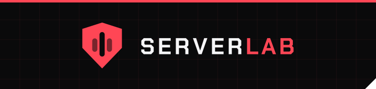
</p>

<p align="center">
  <strong>A small, Grafana-like dashboard for one homelab server.</strong><br>
  Watch what runs on it, how hard it works and who signs in, and manage its firewall and fail2ban from pages that teach you the command line.
</p>

<p align="center">
  <a href="https://github.com/JoshWAMiasco/server_lab/releases/latest"></a>
  <a href="https://github.com/JoshWAMiasco/server_lab/actions/workflows/ci.yml"></a>
  <a href="LICENSE"></a>
  
  
</p>

<p align="center">
  <a href="#features">Features</a> ·
  <a href="#install">Install</a> ·
  <a href="#security-model">Security model</a> ·
  <a href="#develop">Develop</a> ·
  <a href="docs/HARDENING.md">Hardening guide</a>
</p>

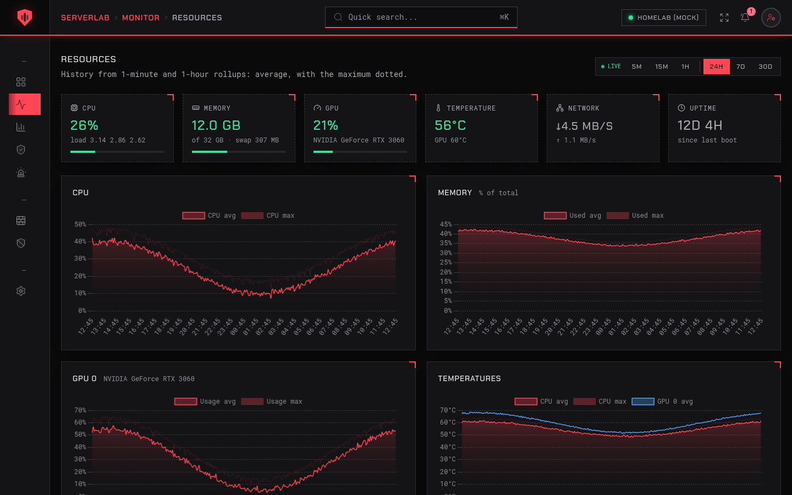

## Why ServerLab

Most monitoring stacks are built for fleets: a time-series database, an agent, a dashboard server and an afternoon of configuration. ServerLab is for the one box under your desk.

- **One install, no extra services.** It runs on the server it watches and keeps everything in a single SQLite file.
- **Private by default.** It is reachable only over your [Tailscale](https://tailscale.com) tailnet, behind nginx, with one admin account. No Tailscale? The [standalone installer](#without-tailscale-standalone-installer) publishes it on a port you choose.
- **Knows a homelab.** It finds your Docker containers, systemd services, nginx sites and databases on its own, and tells you when something is exposed to your LAN.
- **Teaches as you go.** The Firewall and fail2ban pages show the exact `ufw` and `fail2ban-client` command behind every button.

## Features

### Lobby: everything hosted on the server

Cards for every container, service, website and database, with icons, health, uptime and an **Open** link. Anything listening on your LAN instead of only the tailnet gets an "Exposed to LAN" warning. Add what it misses by hand, with your own icon.

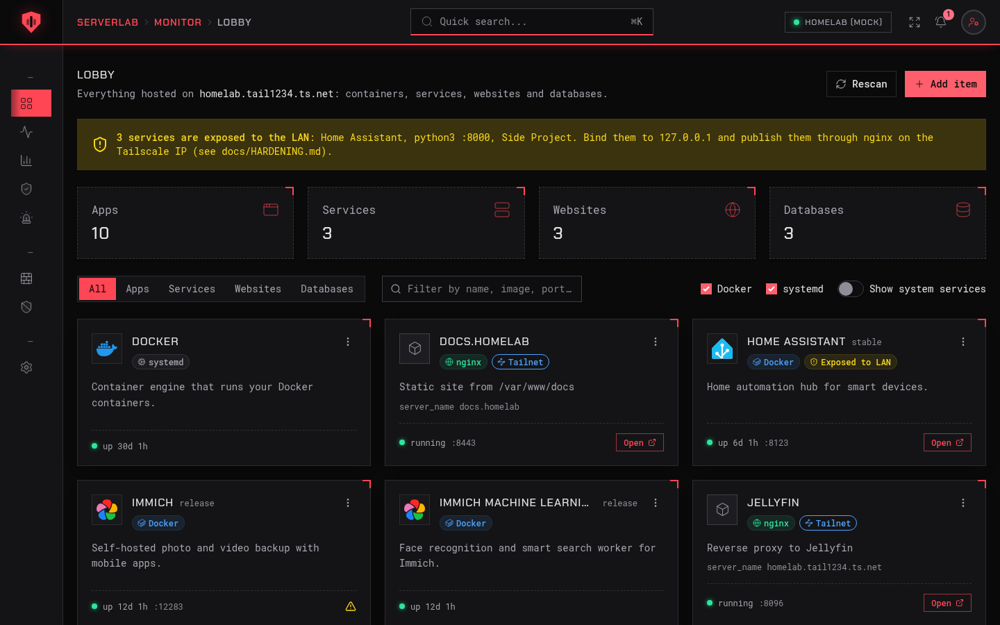

### Resources: live and historical metrics

CPU (total and per core), memory and swap, GPUs (NVIDIA, AMD and Intel, several at once), temperatures, network, disk usage and I/O. Live every 2 seconds, with 24-hour, 7-day and 30-day history.

### Applications: who is using the box

CPU and memory per container and per service, ranked, as a share of the host and in the same units `docker stats` and `systemctl status` use.

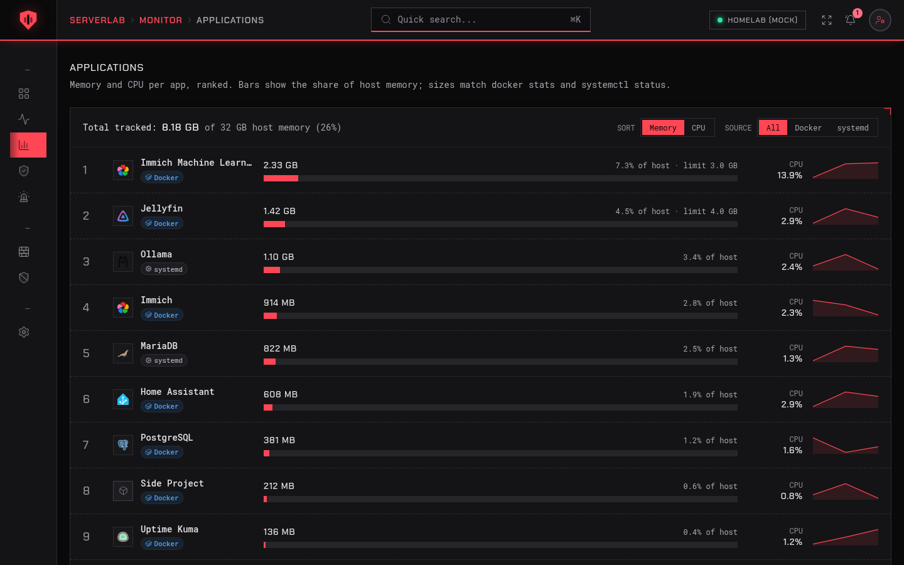

### User Watcher: who signed in, and from where

SSH, console and ServerLab sign-ins with result, method, address and offline geolocation (country and city). Tailnet devices are named. History already on the server is imported on first run.

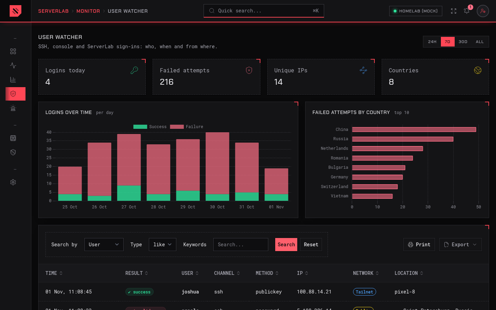

### Alerts

Ready-made rules for high CPU or memory, hot CPU or GPU, disk almost full, SSH brute force, login from a new country, a service going down or becoming exposed, and an expiring TLS certificate. Edit them or add your own. Alerts appear in the app and can go to **ntfy**, **Discord** or **Telegram**.

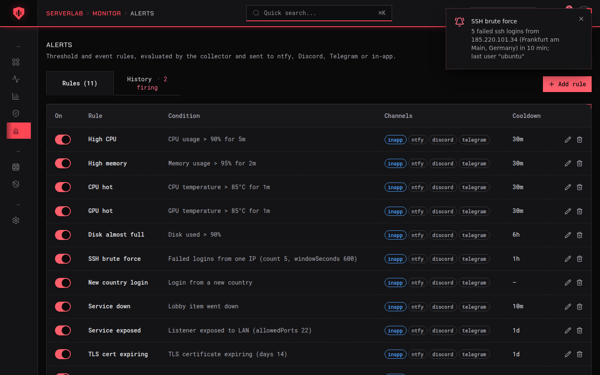

### Firewall: manage UFW, learn UFW

Turn UFW on and off, set the default policies and logging, read the numbered rules and delete them, and add rules from a form with presets. **Every control shows the command it runs**, and the preview updates as you type:

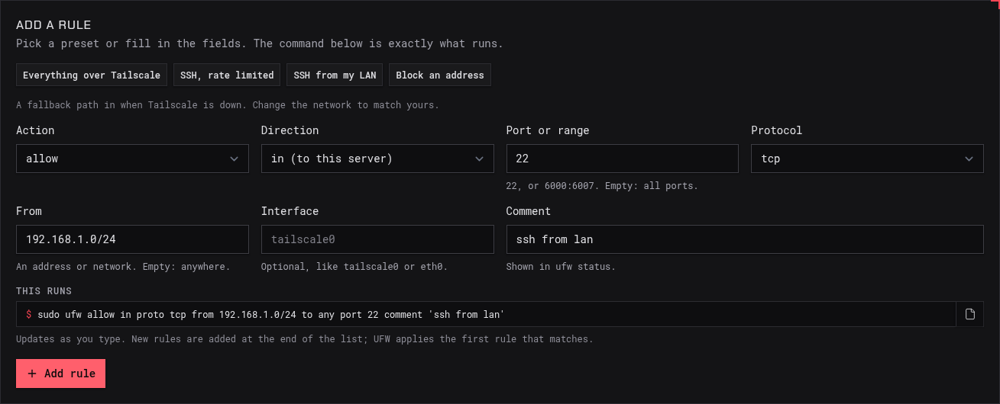

- The page won't turn the firewall on, or remove the last rule that lets you in over SSH or Tailscale, until you confirm you have another way into the machine.
- While UFW is off, it shows your saved rules (`ufw show added`), so you can check them before enabling.
- A built-in reference lists the commands for everything else, plus the classic Docker-bypasses-UFW gotcha.

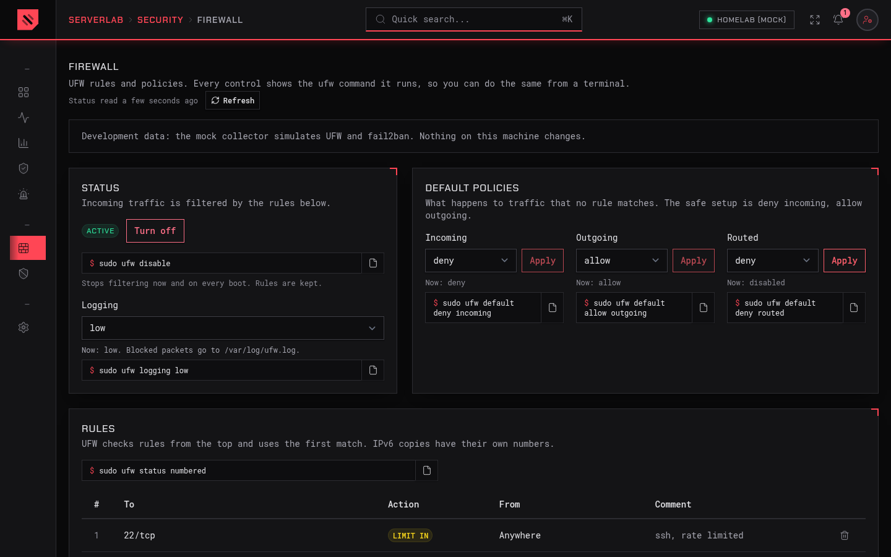

### fail2ban: see bans, lift bans

Every jail with its failed and banned counts, ban rules ("5 tries in 10m, banned for 1h") and the banned addresses, each with an **Unban** button. Ban an address by hand. If fail2ban isn't installed or running, the page walks you through setting it up and gives you a starter `jail.local` that never bans your tailnet.

| A jail | The activity log |
|---|---|
| 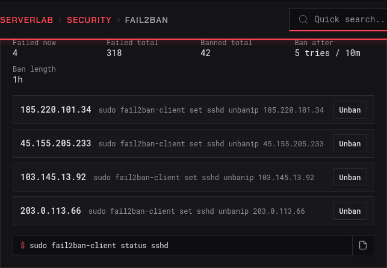 | 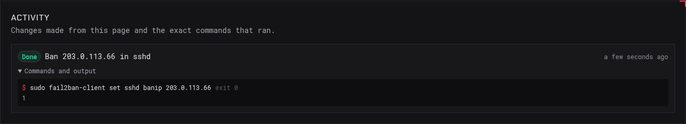 |

Every change lands in an activity log with the exact command that ran, its exit code and its output, so you can repeat it in a terminal.

### Works on your phone

On a phone the menu becomes a drawer: tap outside it, tap a link or press Escape to close it. Every page fits the screen without sideways scrolling.

<p align="center">
  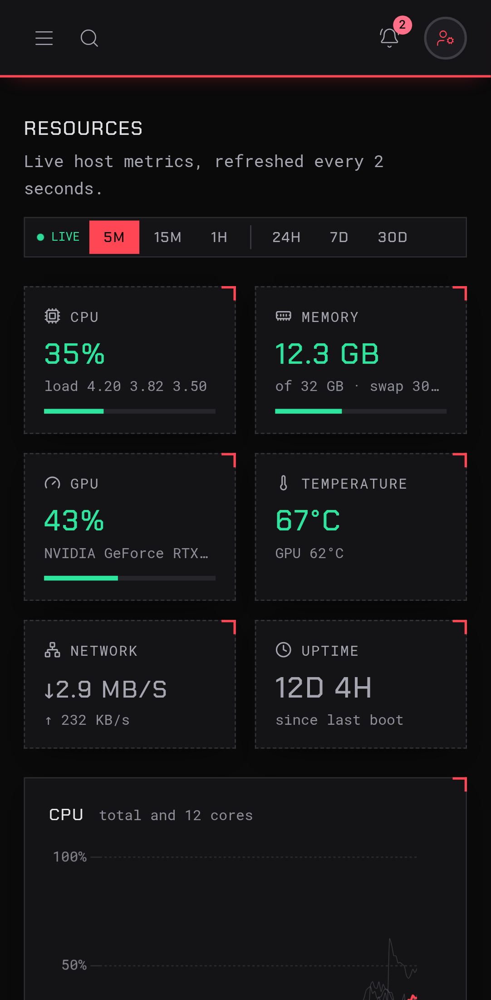
  &nbsp;&nbsp;
  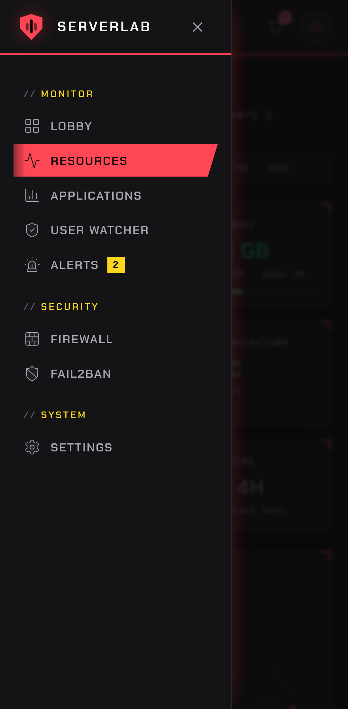
  &nbsp;&nbsp;
  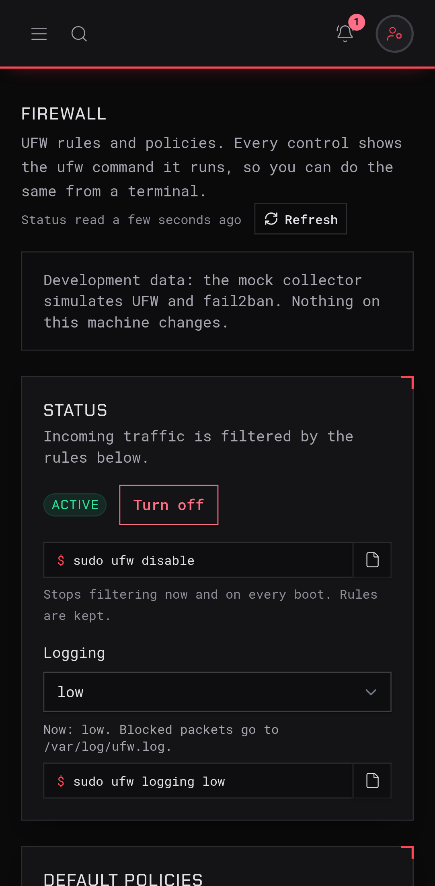
</p>

### And the rest

- **Quick search** (⌘K) across pages and everything in the Lobby.
- **Settings:** data retention, the host name used in links, notification channels with test buttons, active sessions and the admin password.
- **NVIDIA GPU power switch** for hybrid-graphics laptops used as servers (opt-in).
- **First-run setup** with a one-time token printed by the installer.

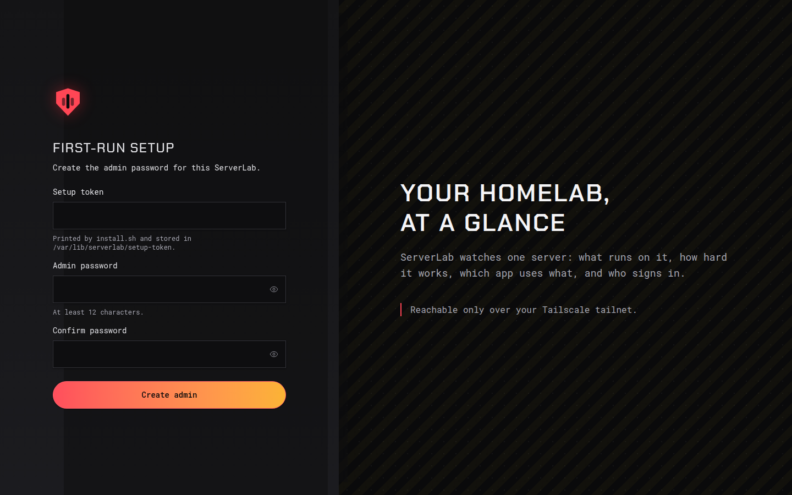

## Install

You need:
- Ubuntu Server 22.04, 24.04, 25.x or 26.04;
- Node.js 22 or later, installed system-wide ([from NodeSource](docs/HARDENING.md#1-before-you-start); on Ubuntu 26.04 `sudo apt install nodejs` is enough);
- [Tailscale](https://tailscale.com/download/linux).

```bash
git clone https://github.com/JoshWAMiasco/server_lab.git
cd server_lab
sudo deploy/install.sh
```

The installer:

1. creates an unprivileged `serverlab` user and builds the app into `/opt/serverlab`;
2. writes `/etc/serverlab/serverlab.env` and creates the database in `/var/lib/serverlab`;
3. downloads the offline geolocation database (monthly updates via a timer);
4. installs and starts the systemd services, plus the firewall/fail2ban helper and its polkit rule;
5. prints a one-time setup token. Open `/setup` to create your admin password.

Then follow the **[hardening guide](docs/HARDENING.md)**: Tailscale, nginx as the only way in, UFW, SSH and fail2ban, with a checklist to verify each step.

| Task | Command |
|---|---|
| Update | `git pull && sudo deploy/install.sh` |
| Reset the admin password | `sudo serverlab reset-password` |
| Remove (keep data) | `sudo deploy/install.sh --uninstall` |
| Remove everything | `sudo deploy/install.sh --uninstall --purge` |

fail2ban is optional and not installed for you. The fail2ban page shows how.

### Without Tailscale: standalone installer

For a server on your LAN (or anywhere you don't run Tailscale), download `serverlab-installer-<version>.zip` from the [latest release](https://github.com/JoshWAMiasco/server_lab/releases/latest). Copy it to the Ubuntu server, then:

```bash
unzip serverlab-installer-*.zip
cd serverlab-installer-*/
sudo bash install.sh --port 8443
```

One script does everything:

- installs Node.js 22, nginx and the other packages it needs (it asks first);
- installs ServerLab;
- puts nginx in front of it on the port you choose, with a self-signed HTTPS certificate;
- opens that port in UFW if UFW is active;
- prints the address and the one-time setup token.

| Option | What it does |
|---|---|
| `--port N` | The port you open in the browser (default `8443`) |
| `--http` | Plain HTTP instead of HTTPS. Only on a network you trust: passwords are sent unencrypted |
| `--hostname NAME` | Name or IP used in links and the certificate (default: the server's IP) |
| `--allow-from CIDR` | With UFW active, allow only this network, e.g. `192.168.1.0/24` |
| `--app-port N` | Internal port of the app on `127.0.0.1` (default `3000`; change it if Grafana or another app uses 3000) |
| `--uninstall [--purge]` | Remove ServerLab (`--purge` also deletes its data) |

Your browser warns once about the self-signed certificate; the installer prints its fingerprint so you can check it. To update, unzip a newer installer and run `sudo bash install.sh` again: your port and other choices are remembered.

The app itself never listens on the network: nginx is always in front, so visitors can't fake their IP address to get around sign-in throttling.

## Security model

```
 browser ──tailnet──▶ nginx (Tailscale IP, TLS) ──▶ serverlab-web  (Next.js on 127.0.0.1:3000)
                                                         │  reads data, queues requests
                                                         ▼
                                                   SQLite (/var/lib/serverlab)
                                                         ▲  writes samples, runs requests
                                                         │
                                                  serverlab-collector ──▶ /proc, /sys, Docker (GET only),
                                                         │                 journal, nginx configs, GPU tools
                                                         ▼  firewall / fail2ban changes only
                                       serverlab-host-action.service  (root, one-shot: ufw + fail2ban-client)
```

- **No root in the app.** The web app and the collector run as `serverlab` under a strict systemd sandbox. The web app never touches the host.
- **Monitoring is read-only.** ServerLab never starts, stops or changes containers and services, and talks to Docker with GET requests only.
- **Changes go through one narrow door.** A polkit rule lets `serverlab` start exactly one root unit. That unit runs a helper that:
  - re-validates every request with the same rules as the web app;
  - refuses symlinks and files it doesn't expect;
  - runs only `ufw` and `fail2ban-client`, with fixed argument shapes and no shell.
- **Sign-in:** one admin with an argon2id-hashed password, session cookies, login throttling, CSP and same-origin checks.

Every privilege, and how to remove it, is listed in [HARDENING §6](docs/HARDENING.md#6-serverlab-process-privileges). Found a problem? See [SECURITY.md](SECURITY.md).

## Develop

ServerLab runs on any OS with Node.js 22. Off Linux (or with `COLLECTOR_DRIVER=mock`), a **mock driver** makes up realistic metrics, containers, logins, firewall rules and fail2ban jails, so every page works without root.

```bash
npm ci
cat > .env.local <<'EOF'
COLLECTOR_DRIVER=mock
DATABASE_PATH=./data/serverlab.db
COOKIE_SECURE=false
EOF
npm run dev
```

Open <http://localhost:3000/setup>. The setup token is printed in the terminal.

| Command | What it does |
|---|---|
| `npm run dev` | Web app and collector together, reloading on change |
| `npm run lint` / `npm run type-check` | ESLint (with the project's naming rules) and TypeScript |
| `npm test` | 456 unit tests: parsers with real command output, validation, the root helper, jobs |
| `npm run build` | Production build of the web app, the collector and the root helper |
| `npm run test:e2e` | 38 Playwright tests on desktop and phone (after `npm run build`; install a browser once with `npx playwright install chromium`) |
| `npm run smoke` | Read-only browser check of a running install (`SERVERLAB_PASSWORD=… BASE_URL=…`) |

Built with Next.js 16, React 19, Tailwind CSS 4, SQLite (better-sqlite3 + Drizzle), Chart.js and Server-Sent Events.

```
app/          Pages, server actions, /api/stream (live data)
components/   UI components
lib/          Shared code: database, schema, queries, authentication, firewall/fail2ban rules
collector/    The metrics process: linux and mock drivers, parsers and fixtures, jobs, alerts
host-action/  The root helper for firewall and fail2ban changes
deploy/       install.sh, systemd units, polkit rules, nginx examples
e2e/          Playwright tests
docs/         Hardening guide, design notes, validation report, screenshots
```

Contributions are welcome. Read [CONTRIBUTING.md](CONTRIBUTING.md) first.

## Known limitations

- **Listener process names.** The collector is unprivileged, so `ss -p` names only processes it owns. Other listeners appear as "Port N"; exposure checks still work.
- **Intel GPU stats** need `intel_gpu_top` and `CAP_PERFMON` (see the hardening guide).
- **nginx inside Docker** is not parsed; its container shows as a normal app.
- **Docker bypasses UFW** for published ports. Publish containers on `127.0.0.1` and expose them through nginx.

## Credits

- Geolocation by [DB-IP](https://db-ip.com): the "IP to City Lite" database, [CC BY 4.0](https://creativecommons.org/licenses/by/4.0/). It is downloaded at install time and monthly, not stored here.
- Application icons in `catalog/icons/` come from [dashboard-icons](https://github.com/homarr-labs/dashboard-icons) (Apache-2.0). Product names and logos belong to their owners.
- Screenshots show the built-in mock data, not a real server.

## License

[MIT](LICENSE) © 2026 Joshua Miasco
